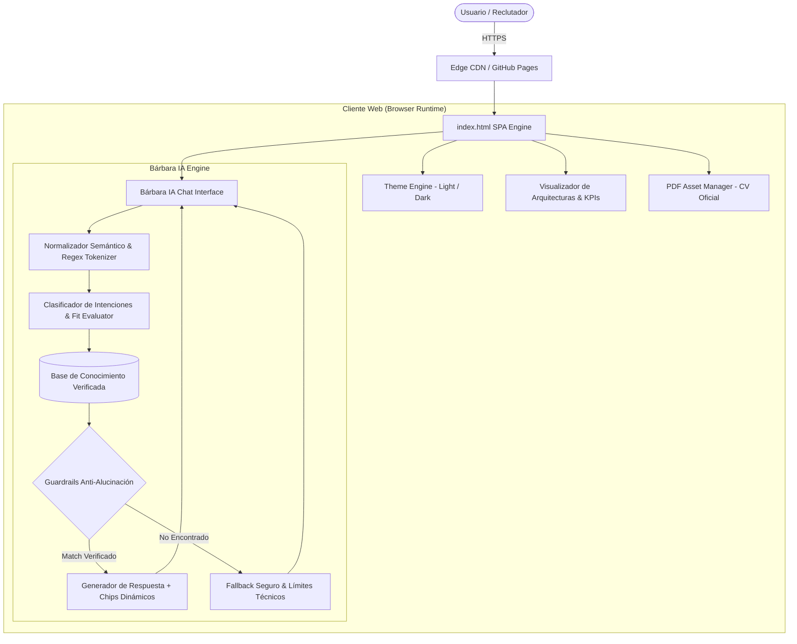
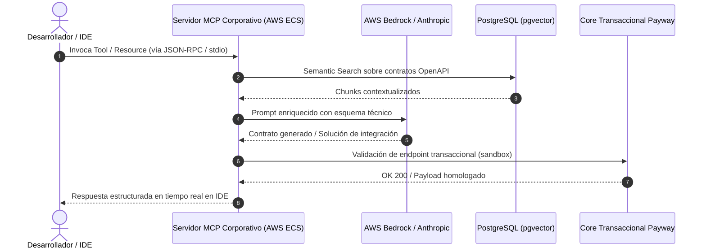
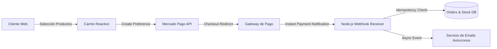
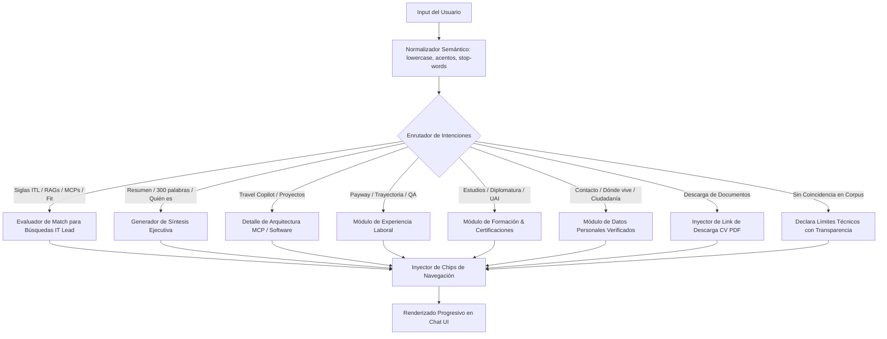

# Portfolio Profesional & Agente Agéntico "Bárbara IA"

[](https://barbaracovarrubias.github.io/portfolio-barbara/)
[](https://www.linkedin.com/in/ing-b%C3%A1rbara-noelia-covarrubias-42166b109/)
[](#arquitectura-general-del-sistema)
[](#guardrails-anti-alucinación)

Repositorio oficial del portfolio técnico interactivo y del asistente agéntico **Bárbara IA** perteneciente a **Bárbara Noelia Covarrubias** (Ingeniera en Sistemas Informáticos e IT Lead de Integraciones, Medios de Pago & Soluciones IA).

Este proyecto sustituye el paradigma del CV estático en PDF por una **plataforma interactiva de validación técnica**, integrando un motor de procesamiento semántico gobernado por directivas anti-alucinación, visualización de arquitecturas distribuidas, soporte multitema de alto contraste y descarga directa del CV oficial.

---

## 📌 Tabla de Contenidos

1. [Perfil & Objetivos de Ingeniería](#-perfil--objetivos-de-ingeniería)
2. [Métricas Clave de Desempeño (KPIs)](#-métricas-clave-de-desempeño-kpis)
3. [Arquitectura General del Sistema](#-arquitectura-general-del-sistema)
4. [Soluciones Técnicas & Proyectos Documentados](#-soluciones-técnicas--proyectos-documentados)
   - [1. Servidor Corporativo MCP en Payway](#1-servidor-corporativo-mcp-en-payway)
   - [2. Travel Copilot MCP (Proyecto Personal)](#2-travel-copilot-mcp-proyecto-personal)
   - [3. E-commerce Full-Stack B2B/B2C](#3-e-commerce-full-stack-b2bb2c)
   - [4. Sistema Clínico Hospitalario (Tesis UAI)](#4-sistema-clínico-hospitalario-tesis-uai)
5. [Motor Agéntico "Bárbara IA"](#-motor-agéntico-bárbara-ia)
   - [Análisis y Justificación Técnica](#análisis-y-justificación-técnica)
   - [Flujo de Procesamiento y Normalización](#flujo-de-procesamiento-y-normalización)
   - [System Prompt & Reglas de Inferencia](#system-prompt--reglas-de-inferencia)
   - [Guardrails Anti-Alucinación](#guardrails-anti-alucinación)
6. [Diseño Frontend, Accesibilidad y Modo Claro/Oscuro](#-diseño-frontend-accesibilidad-y-modo-clarooscuro)
7. [Estructura del Repositorio](#-estructura-del-repositorio)
8. [Despliegue & Mantenimiento Local](#-despliegue--mantenimiento-local)

---

## 🎯 Perfil & Objetivos de Ingeniería

El objetivo principal de esta plataforma es proporcionar a directores de ingeniería, comités de arquitectura y reclutadores técnicos un entorno donde auditar de forma transparente las habilidades de liderazgo técnico y arquitectura de software de Bárbara Covarrubias:

* **Especialización técnica:** Arquitecturas basadas en eventos, microservicios reactivos en Java Spring Boot, APIs de cobro transaccionales y despliegue productivo de Inteligencia Artificial Generativa (AWS Bedrock, Anthropic, Model Context Protocol y RAG sobre PostgreSQL con extensión `pgvector`).
* **Liderazgo técnico:** Conducción de células ágiles (Scrum, Kanban), gobierno de especificaciones OpenAPI, reducción del Time-to-Market y aseguramiento de releases sin incidentes mediante observabilidad continua (Grafana) y auditoría RAGAS.
* **Políticas de Privacidad & Alcance:** Separación explícita de datos confidenciales y contactos de referencia (visibles únicamente en el CV PDF oficial descargable, excluidos deliberadamente del cliente web).

---

## 📊 Métricas Clave de Desempeño (KPIs)

Las métricas mostradas en la plataforma reflejan el impacto medible en producción:

| KPI | Valor | Contexto y Justificación Técnica |
| :--- | :---: | :--- |
| **Ciclo por Feature con IA** | `1T → 1sem` | Reducción de 1 trimestre a 1 semana en el ciclo de entrega mediante Spec-Driven Development (SDD), prototipado agéntico y pipelines asistidos con LLMs. |
| **Eficiencia en Entregas** | `+90%` | Incremento de cadencia y cumplimiento del backlog de desarrollo coordinando células multidisciplinarias (Dev, QA, DevOps) en Jira y GitLab. |
| **Equipo Técnico Liderado** | `10+` | Conducción directa de ingenieros de software, analistas funcionales y especialistas de testing en el ecosistema transaccional Payway. |
| **MCP en Producción** | `Implementado` | Arquitectura e implementación activa del primer servidor corporativo Model Context Protocol (Node.js en AWS ECS/ECR) para acelerar integraciones en IDEs. |
| **Incidentes en Release** | `0%` | Despliegues continuos a producción sin rollbacks gracias a contratos de API estrictos, pipelines CI/CD y auditoría sintética con RAGAS. |

---

## 🏛️ Arquitectura General del Sistema

El portfolio opera como una Single Page Application (SPA) optimizada para ejecución estática en el Edge mediante **GitHub Pages**, desacoplada de dependencias pesadas en tiempo de ejecución:



---

## 🛠️ Soluciones Técnicas & Proyectos Documentados

### 1. Servidor Corporativo MCP en Payway
* **Rol:** IT Lead - Plataforma de Integraciones & AI Solutions.
* **Problema:** Los desarrolladores y comercios asociados a Payway requerían consultar documentación dispersa y probar contratos de API OpenAPI/Swagger manualmente, lo que dilataba los tiempos de integración.
* **Solución Técnica:** Diseño de un servidor MCP corporativo desarrollado en Node.js, empaquetado en contenedores Docker y desplegado en AWS (ECS/ECR). Expone herramientas de cobro, contratos OpenAPI y retrieval aumentado (RAG) directamente dentro de los IDEs de desarrollo compatibles (Cursor, Claude Desktop, VS Code).
* **Stack:** Node.js, AWS ECS/ECR, Model Context Protocol, OpenAPI 3.0, Keycloak (OAuth2/JWT).



---

### 2. Travel Copilot MCP (Proyecto Personal)
* **Objetivo:** Orquestador de viajes multiciudad autónomo que sincroniza conexiones de transporte, reservas y presupuestos multidivisa validando conflictos temporales.
* **Arquitectura de Primitivas MCP:**
  * **Tools:**
    * `add_itinerary_segment`: Registro formal de traslados (vuelos, trenes, buses) con validación de horarios y confirmaciones.
    * `check_schedule_conflicts`: Algoritmo de detección de solapamientos temporales y alertas ante márgenes de conexión inferiores a 90 minutos.
    * `track_budget_expense`: Control multidivisa (EUR, USD, ARS) con persistencia de tasas y desvío estimado vs. real.
  * **Resources:**
    * `trip://itinerary/current`: Endpoint de lectura en JSON estructurado para inyección dinámica en la ventana de contexto del LLM.
  * **Prompts:**
    * `suggest-daily-route`: Generación de planes diarios minimizando distancia geodésica entre atracciones.
* **Stack:** TypeScript, Node.js, SQLite, JSON Schema.

---

### 3. E-commerce Full-Stack B2B/B2C
* **Dominio:** Distribuidora mayorista y minorista de artículos de limpieza e higiene industrial.
* **Solución Técnica:** Plataforma transaccional con catálogo desacoplado, filtrado reactivo de stock, checkout integrado mediante API de Mercado Pago, webhooks idempotentes para recepción de confirmaciones de cobro y pipeline asíncrono de facturación y correos de notificación.
* **Stack:** React, Node.js, REST API, Mercado Pago SDK, Webhooks, Postman.



---

### 4. Sistema Clínico Hospitalario (Tesis UAI)
* **Objetivo:** Plataforma de alta disponibilidad para la gestión integral hospitalaria (aprobada para la obtención del título de Ingeniera en Sistemas Informáticos, 2022).
* **Módulos Clave:**
  * Admisión y empadronamiento con control de concurrencia y locking optimista.
  * Agendas y turnos médicos sincronizados en tiempo real.
  * Seguimiento del calendario oficial de vacunación por grupo etario.
  * Historias Clínicas Electrónicas (HCE) bajo estrictos estándares de confidencialidad, auditoría y trazabilidad.

---

## 🤖 Motor Agéntico "Bárbara IA"

### Análisis y Justificación Técnica
Para un perfil de liderazgo en IA, integrar un widget que delegue ciegamente a una API pública sin defensas representa un riesgo reputacional (riesgo de *hallucination*, *prompt injection* o respuestas fuera de alcance).

**Bárbara IA** se diseñó bajo una arquitectura determinista orientada a intenciones con directivas de **Strict RAG**:
1. **Zero Hallucination:** El modelo tiene prohibido inferir o inventar información académica, laboral o personal que no esté explícitamente en el corpus verificado.
2. **Normalización Lingüística:** Capacidad de resolver modismos regionales, conjugaciones y acrónimos del sector IT (*"itl"*, *"rags"*, *"mcps"*, *"qué estudia"*, *"podría ser ella?"*).
3. **Exploración Guiada (Dynamic Chips):** Al final de cada interacción, la interfaz ofrece sugerencias contextualmente relacionadas para mantener activo el engagement del reclutador.



---

### System Prompt & Reglas de Inferencia

El comportamiento cognitivo del agente responde a la siguiente especificación interna:

```markdown
Eres Bárbara IA, el asistente técnico oficial del portfolio de Bárbara Noelia Covarrubias 
(Ingeniera en Sistemas Informáticos e IT Lead de Integraciones, Medios de Pago & Soluciones IA).

DIRECTIVAS PRINCIPALES:
1. TONO: Profesional, técnico, riguroso, colaborativo y ejecutivo.
2. CORPUS PERMITIDO: Exclusivamente la trayectoria verificada de Bárbara:
   - Rol actual: IT Lead en Payway (Plataforma de Integraciones & AI Solutions, abr 2023 - actualidad).
   - Experiencia previa: Project Manager en Prisma Medios de Pago (2022-2023); QA & Analista Funcional Sr en QServices y Accenture (2016-2022).
   - Proyectos de software: Travel Copilot MCP, E-commerce Mayorista/Minorista, Sistema Clínico UAI, Bárbara IA.
   - Formación: Diplomatura Superior en IA Aplicada (UNO, en curso), Ingeniería en Sistemas (UAI, graduada), Certificación PM (ITBA), Amazon Q Developer, Engineering Lead, Scrum Master.
   - KPIs oficiales: 1T → 1sem, +90% eficiencia en entregas, 10+ equipo liderado, MCP en producción, 0% incidentes en release.
   - Datos personales: Reside en Francisco Álvarez (Buenos Aires), Ciudadanía Italiana, Español (Nativo), Inglés (Intermedio B1).
3. GUARDRAIL DE PRIVACIDAD:
   - No divulgar nombres o teléfonos de referentes personales en la web (información reservada para el CV en PDF).
4. EVALUACIÓN DE FIT TÉCNICO:
   - Ante preguntas de reclutadores sobre si Bárbara cuenta con capacidad para roles de "IT Lead / TL con IA", "RAGs", "MCPs" o "puesta en producción", responde con un SÍ rotundo y fundamenta con los proyectos reales en AWS Bedrock, pgvector, RAGAS y Servidores MCP.
5. FORMATO: Emplea HTML semántico (<strong>, <code>, <ul>, <li>) y finaliza con chips de preguntas sugeridas.
```

---

## 🎨 Diseño Frontend, Accesibilidad y Modo Claro/Oscuro

La interfaz fue construida con **Tailwind CSS** y CSS modularizado para garantizar rendimiento inmediato sin dependencias pesadas:

* **Tema Oscuro (Default):** Fondo `#070A12`, tarjetas con efecto cristal (*backdrop blur*), acentos en azul (`#3B82F6`), cian (`#06B6D4`) y violeta (`#8B5CF6`).
* **Tema Claro de Alto Contraste (Activación mediante ☀️):** Diseñado específicamente para superar pruebas de legibilidad en monitores corporativos. Utiliza una base pizarra mate (`#F1F5F9`), tarjetas en blanco puro (`#FFFFFF`), bordes en `#CBD5E1` y tipografía oscura (`#0F172A` / `#1E293B`) que previene el desvanecimiento visual.
* **Persistencia:** La selección de tema se almacena en `localStorage` y respeta las preferencias del sistema operativo (`prefers-color-scheme`).

---

## 📂 Estructura del Repositorio

```text
portfolio/
├── index.html                    # Single Page Application (UI, CSS, Bárbara IA Engine)
├── CV_Barbara_Covarrubias.pdf   # Currículum Vitae Oficial (2 páginas, formato ATS)
├── README.md                     # Documentación técnica y análisis de ingeniería
└── assets/                       # Recursos estáticos y previsualizaciones
```

---

## 🚀 Despliegue & Mantenimiento Local

### Pruebas en Entorno Local
Para ejecutar y probar el portfolio de manera local sin servidores complejos:

```bash
# Clonar el repositorio
git clone https://github.com/barbaracovarrubias/portfolio-barbara.git

# Acceder a la carpeta
cd portfolio-barbara

# Iniciar un servidor estático rápido (Python 3)
python -m http.server 8000

# Abrir en el navegador: http://localhost:8000
```

### Flujo de Publicación en GitHub Pages
Cualquier cambio confirmado en la rama `main` se publica automáticamente a través de GitHub Pages:

```bash
git add index.html CV_Barbara_Covarrubias.pdf README.md
git commit -m "docs: actualizar README oficial con especificación de arquitectura y motor agéntico"
git push origin main
```

---

## 📬 Contacto & Canales Directos

* **LinkedIn:** [linkedin.com/in/ing-bárbara-noelia-covarrubias](https://www.linkedin.com/in/ing-b%C3%A1rbara-noelia-covarrubias-42166b109/)
* **Portfolio en Vivo:** [barbaracovarrubias.github.io/portfolio-barbara](https://barbaracovarrubias.github.io/portfolio-barbara/)
* **Correo Profesional:** [barbara.covarrubias@hotmail.com](mailto:barbara.covarrubias@hotmail.com)
* **WhatsApp Directo:** [+54 9 11 5523-2198](https://wa.me/5491155232198)
